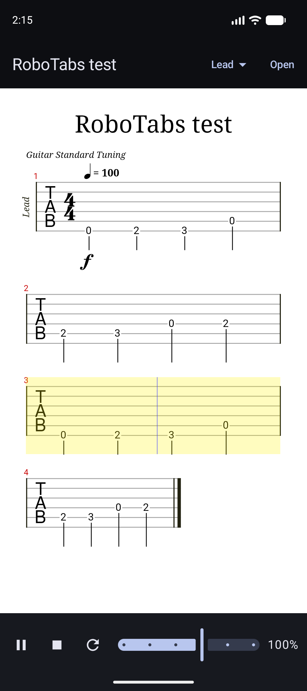

# RoboTabs

An Android app for reading and playing guitar tabs. Open a Guitar Pro, MusicXML or alphaTex file and RoboTabs renders it as tablature and plays it back, with a cursor that follows the music.



## Features

- Opens Guitar Pro (.gp3, .gp4, .gp5, .gpx, .gp), MusicXML and alphaTex files through the system file picker
- Keeps added tabs in a library, so a song is one tap away next time. Adding the same file twice keeps one copy
- Plays the tab with a built-in synthesizer, so it works offline and needs no extra downloads
- Play, pause, stop and loop
- Playback speed from 25% to 150% for practising slowly
- Track picker for files with several instruments
- Pauses when the app goes to the background
- A clear message instead of a crash when a file is not a tab or is too large to be one (over 20 MB)

Plain text tabs (dashes and numbers) are not supported. They do not record rhythm, so they cannot be played back.

## Try it

`samples/two-tracks.atex` is a short two-track tab. Copy it to the phone and add it from the app.

Other ways to get files:

- Guitar Pro files from tab sites
- Your own tabs written in [TuxGuitar](https://www.tuxguitar.app/) (free) or exported as MusicXML from [MuseScore](https://musescore.org/) (free)
- alphaTex, a plain-text format you can write by hand ([syntax](https://alphatab.net/docs/alphatex/introduction))

The app has no song catalogue and downloads nothing. Tabs are usually copyrighted transcriptions, so use files you are allowed to have.

## Tech stack

- Kotlin 2.4, Jetpack Compose, Material 3
- MVVM: `ViewModel` with `StateFlow` for screen state and a `Channel` for one-off errors
- Coroutines for file reading and parsing off the main thread
- [alphaTab](https://alphatab.net/) for rendering and MIDI playback, hosted in Compose through `AndroidView`
- Storage Access Framework for opening files, so no storage permission is needed
- Library stored as plain files in app storage: each tab under the SHA-256 of its content, plus a JSON index written atomically (temp file, fsync, rename). The tab files are the source of truth, so a lost, corrupt or outdated index is rebuilt from them on the next start
- 28 JVM unit tests (JUnit, kotlinx-coroutines-test) for the library, the tab ViewModel and the alphaTab parser. Each guard against a real bug was checked by planting that bug and watching the test fail

## Problems solved

alphaTab's Android build is much younger than its web version, and getting it to work took some digging in its source:

- **The last row of every tab was missing.** Measuring the render surface against the final score size showed the surface was sized from partial render results only (1309 px tall against the 1712 px the score needed), so the last system fell outside it. `AlphaTabSurfaceSize.kt` applies the final size when rendering finishes. It uses reflection on a private field, so it must be checked again whenever alphaTab is upgraded.
- **`api.load(bytes)` always returned false.** Its Kotlin `when` compares the data with a Boolean instead of checking its type. RoboTabs parses files with `ScoreLoader` directly instead.
- **A non-tab file crashed the app.** alphaTab's errors extend `Throwable`, not `Exception`, so a normal `catch (e: Exception)` misses them.
- **Reopening a song left the sheet blank for several seconds.** The log said `skipped rendering because of width=0`: alphaTab reads the view width at the moment rendering starts, and a song already in memory was handed over before the view was laid out. Rendering now starts in `doOnLayout`.

## Project structure

```
app/src/main/java/com/robo/robotabs/
  MainActivity.kt            switches between the library and the player
  RoboTabsApp.kt             owns the single SongLibrary
  library/
    SongLibrary.kt           stores tabs and the index on disk
    ReadLimited.kt           reads a picked file with a size cap
    LibraryViewModel.kt      adding and deleting songs
    LibraryScreen.kt         song list
  player/
    TabViewModel.kt          loads a song from the library
    TabScreen.kt             Compose UI, hosts AlphaTabView
    Playback.kt              player state and controls
    ScoreParser.kt           alphaTab parsing with its Throwable errors handled
    AlphaTabSurfaceSize.kt   workaround for the cut-off last row
```

## Building

Requirements: Android Studio with JDK 17 or newer and Android SDK 37. The app runs on Android 8.0 (API 26) and newer.

```
./gradlew :app:assembleDebug
```

The debug APK is about 59 MB because alphaTab ships Skia native libraries for every CPU architecture.

## Related

[RoboTuner](https://github.com/Rostanic20/RoboTuner), a guitar tuner app by the same author.

## Licenses

- alphaTab: [MPL-2.0](https://github.com/CoderLine/alphaTab/blob/main/LICENSE)
- The Sonivox SoundFont bundled with alphaTab: Apache License 2.0, Copyright (c) 2004-2006 Sonic Network Inc.
